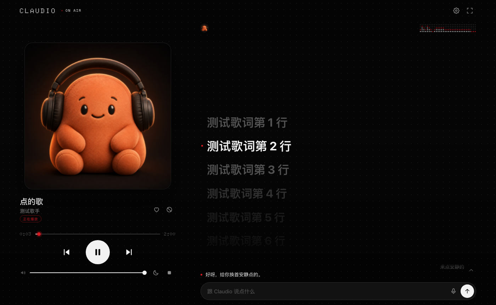
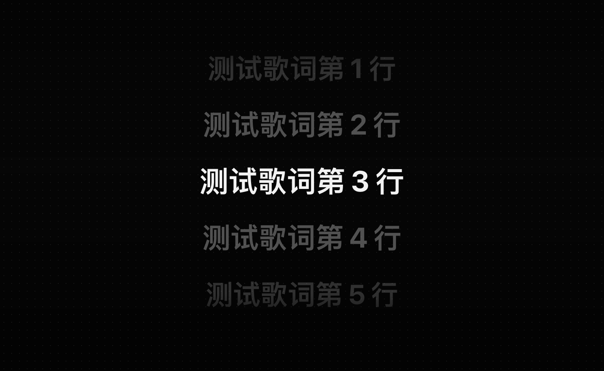
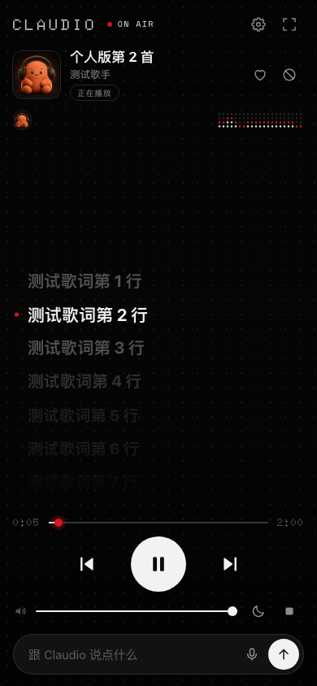
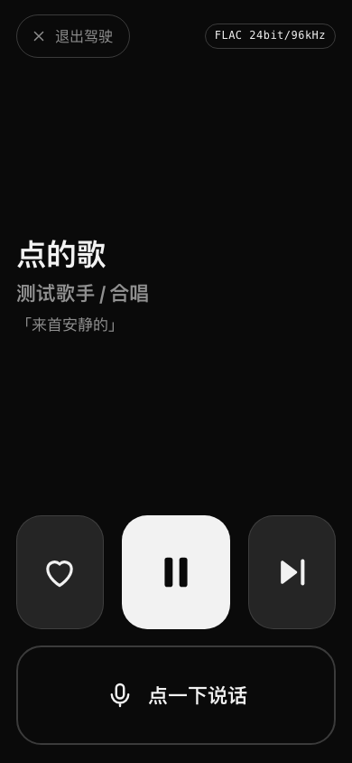
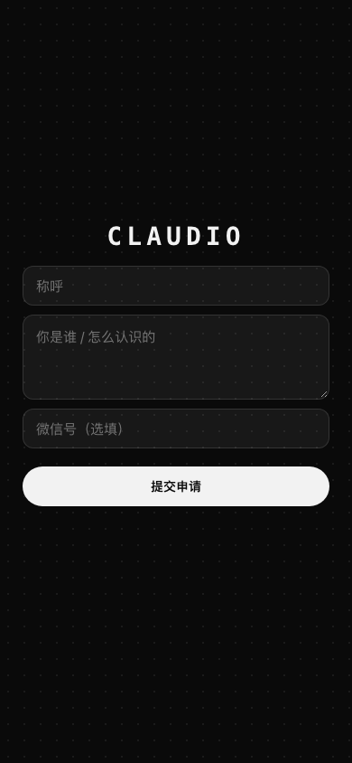
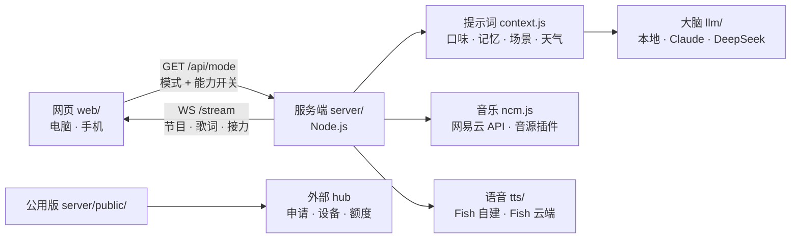

<p align="center">
  
</p>

<h1 align="center">Claudio</h1>

<p align="center">一个会聊天、懂你口味的 AI 电台：大模型当 DJ 选歌、写口播，语音念出来。</p>

<p align="center">
  <a href="https://github.com/leo123-tto/claudio/actions/workflows/test.yml"></a>
  <a href="./LICENSE"></a>
</p>

## 为什么

听歌软件的推荐不知道你此刻在干什么：上班要专注，午休想放空，开车要提神，它给的都差不多。想换口味，还得自己翻歌单。手机、电脑换着听，换一台就断了。

Claudio 让大模型当你的私人 DJ：它记得你的口味和最近听了什么，看一眼现在几点、星期几、天气怎样，挑几首歌，像电台主持人那样说两句再放。你可以直接跟它说「来点安静的」。换一台设备打开，从刚才那首接着放。

## 怎么参与

| 想做什么 | 去哪里 |
|---|---|
| **免部署直接用** | 申请维护者运营的公开版：[申请邀请](https://dj.ajkb.app/apply)（已有邀请的从 [首页](https://dj.ajkb.app) 进） |
| **提意见** | 开 issue：[报 bug](https://github.com/leo123-tto/claudio/issues/new?template=bug.yml) · [提建议](https://github.com/leo123-tto/claudio/issues/new?template=feature.yml) |
| **提交代码** | 提 PR，维护者合并后部署到公开版，大家在网站上就能用到：[怎么加、改界面功能](./docs/上手指南.md#三手把手在播放界面加一个按钮) |
| **自己改、自己用** | fork 后自行部署：[自部署指南](./docs/自部署.md) |

## 亮点

- **记忆和口味**：读你的口味描述和收藏，DJ 自己记下你说过的偏好。
- **按时间场景推荐**：工作日、周末、上班、午休，挑的歌不一样。
- **对话点歌**：「来点钢琴」「换首安静的」「这首不喜欢」，直接说。
- **语音口播**：每期开头像电台主持人一样说两句，压在上一首的尾奏上。
- **多设备接力**：一台开始响，别的自动停；换设备从刚才那首接着放。
- **沉浸歌词**：全屏大字歌词，平滑滚动。
- **驾驶模式**：大按键、口播只说一句、点一下说话点歌，屏幕常亮。
- **真实音质**：显示这首歌实际拿到的格式和规格（如 FLAC 24bit/96kHz），拿不到就不显示，不虚标。
- **邀请制公用版**：几个朋友一起用，每人绑定自己的网易云账号。
- **可自部署**：大脑、语音、音源都可插拔，一台常开的机器就能跑。

## 截图

| 电脑 | 沉浸歌词 |
|:---:|:---:|
|  |  |

| 手机 | 驾驶模式 | 公用版申请页 |
|:---:|:---:|:---:|
|  |  |  |

<sub>截图用的是测试数据。</sub>

## 公开版使用须知

- 邀请制：在 [申请页](https://dj.ajkb.app/apply) 填表，维护者批了才能用。
- 每人每天有次数额度，用完第二天恢复。请勿滥用，别用脚本批量请求。
- 歌曲、歌词的版权归各音乐平台和权利人所有。
- 这是个人维护的业余项目，不保证随时可用，可能随时调整或停止。

## 架构



- **个人版**（默认）：一个人的电台，口味在本机 `user/`。
- **公用版**（`CLAUDIO_MODE=public`）：邀请制多人版，进门交给外部 hub（[接口](./docs/hub-api.md)）。
- 两版用同一份网页，服务端 `/api/mode` 告诉网页是哪一版、露哪些按钮。详见 [架构文档](./docs/architecture.md)。

## 快速开始

需要 Node.js 20+。

```bash
npm install
cp .env.example .env                  # 按注释填（全部留空也能起，只是没有大脑和语音）
cp -r packaging/default-user user     # 你的口味档案（user/ 不进仓库）
npm run ncm                           # 终端 1：网易云 API（:3000）
npm run dev                           # 终端 2：Claudio，打开 http://localhost:8080
```

想听到歌：`npm run login:ncm` 登录网易云，再在网页右上角 ⚙ 把大脑切到 DeepSeek（`.env` 填 `DEEPSEEK_API_KEY`）或 Claude（本机已登录 `claude` CLI）。语音可以不配，那样只放歌、口播出文字。

详细步骤、代码地图、手机调试：[上手指南](./docs/上手指南.md)。

## 文档

| 文档 | 内容 |
|---|---|
| [上手指南](./docs/上手指南.md) | 本地跑起来、代码地图、加按钮的例子、手机调试、常见坑 |
| [自部署指南](./docs/自部署.md) | 自己部署个人版 / 公用版，大脑、语音、网易云的可选项 |
| [CONTRIBUTING](./CONTRIBUTING.md) | 提 PR 的流程、分工、测试、安全红线、用 AI 写码 |
| [AGENTS.md](./AGENTS.md) | 项目总文档：架构、技术栈、接口契约、已知风险 |
| [architecture](./docs/architecture.md) · [hub-api](./docs/hub-api.md) · [references](./docs/references.md) | 四层架构 · 公用版 hub 接口 · 参考资料 |
| [SECURITY](./SECURITY.md) · [行为准则](./CODE_OF_CONDUCT.md) | 安全问题怎么报 · 社区规矩 |

## 给 AI 编码助手

先读 [AGENTS.md](./AGENTS.md)（[CLAUDE.md](./CLAUDE.md) 同内容），开头一段就是项目要点。最要紧的约定：

- **两种模式**：个人版（默认）和公用版（`CLAUDIO_MODE=public`，`server/public/`）。网页 `web/` 两版共用，播放引擎分开：`app.js`（个人）、`public.js`（公用）。
- **能力开关**：`web/index.html` 里带 `data-cap="x"` 的控件默认隐藏，`/api/mode` 回的 `features.x` 为真才露出。个人版开关在 `server/index.js` 和 `web/boot.js` 的 `PERSONAL`，公用版在 `server/public/app.js`。
- **测试**：`npm test`（`node --test`，不联网），提交前必须全过；改了什么补什么测试。
- **前端**：原生 JS，不引框架；不写内联脚本，不引外部资源（公用版有 CSP）。
- **安全红线**：不提交密钥、cookie、`.env`、`user/`、日志、内网地址；不写绕过平台限制、伪装客户端的代码；音源只走插件接口（`server/sources.js`），仓库里不放具体音源。
- **改动原则**：最小必要改动，沿用现有风格，新依赖先说明；`AGENTS.md` 和 `CLAUDE.md` 改一份同步另一份。

## 声明

音乐直链来自第三方网易云 API，仅建议个人学习和自用；请自行遵守所在地法律、平台条款和音乐版权规则。

## License

[MIT](./LICENSE)
